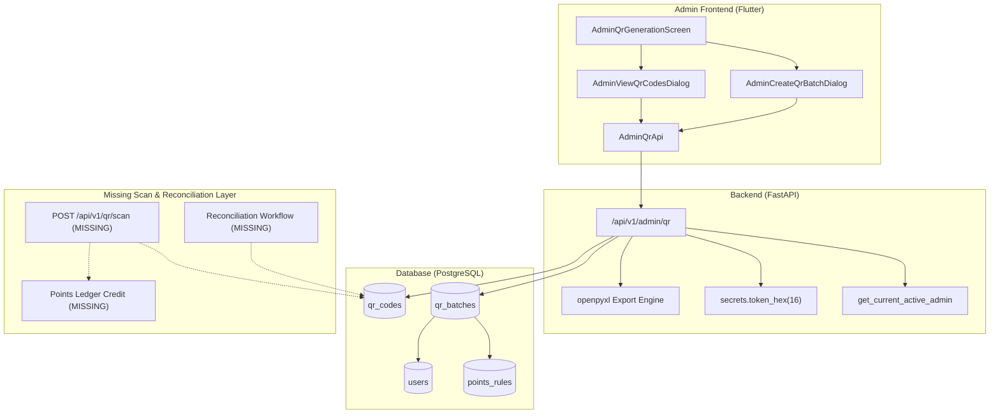

# Score_App — Admin QR Code Implementation Audit Report

**Date of Audit:** October 26, 2026  
**Auditor:** Antigravity Senior Engineering Inspection Team  
**Scope:** Verification and code-level audit of the QR Code Generation and Management feature in `Score_App`.  
**Mode:** Inspection-Only (Non-destructive, zero code or database alterations).

---

## 1. Executive Summary

This audit provides a comprehensive, code-level inspection of the QR Code Implementation in `Score_App` across both the FastAPI backend and Flutter/Dart frontend. 

The audit compared the actual codebase against the agreed Score_App requirements:
- **What is genuinely implemented:** The administrative QR batch generation lifecycle is fully functional. Administrators can generate cryptographically secure batches of QR codes for four categories (`product`, `invoice`, `staff`, `partner`), view generated codes with rendered QR matrix graphics via `qr_flutter`, export batches to styled Excel `.xlsx` spreadsheets (via `openpyxl`) and raw CSV, and administratively void or reactivate individual unredeemed tokens. All 9 backend test cases and 14 Flutter unit/widget test cases pass with 100% success.
- **What is generation-only:** The current system is purely an **administrative issuance and export tool**. While QR tokens and custom deep link payloads (`score://qr/v1?token=...&type=...`) are properly formatted and persisted in the database, there is **no operational engine** for scanning, resolving, or transacting against these codes.
- **Critical missing pieces:** 
  1. *Scan / Redemption API:* No backend endpoint exists for users (customers, partners, or staff) to scan, validate, or redeem a QR token.
  2. *Reconciliation Engine (`after_reconcile`):* Contrary to the agreed requirement that codes remain inert until reconciled, newly generated codes are immediately marked with `status="active"` (`server_default="active"`). No reconciliation workflow, model, or status exists.
  3. *Relational Linkage for Invoices:* The database model lacks an `order_id` or `invoice_id` foreign key. "Invoice QR" batches generate tokens with null relational references.
  4. *Physical Unit Tracking:* Product QR codes associate to catalogue items (`products.id`), but the schema does not track physical unit serial numbers or inventory lots.

---

## 2. Implementation Inventory

The following files were inspected and verified against the claims made for the QR feature:

| File / Component | Type | Verified Status | Summary of Responsibility |
| :--- | :--- | :--- | :--- |
| `backend/app/models.py` | Backend ORM | Verified Present | `QrBatch` and `QrCode` models with foreign keys, check constraints, indexes, and relationships. |
| `backend/app/schemas/admin_qr.py` | Backend Schemas | Verified Present | Pydantic v2 schemas: `QrBatchCreate`, `QrBatchResponse`, `QrCodeResponse`, `QrCodeStatusUpdate`, `QrBatchListResponse`, `QrCodeListResponse`. |
| `backend/app/routers/admin_qr.py` | Backend Router | Verified Present | 7 endpoints: Batch creation, batch listing, batch details, paginated code retrieval, Excel export, CSV export, and code status update. |
| `backend/app/main.py` | App Entrypoint | Verified Present | Mounted router at `/api/v1/admin/qr` under `admin_qr` tag. CORS exposed header `Content-Disposition`. |
| `backend/migrations/versions/b2c3d4e5f6a7_create_qr_batches_and_codes_tables.py` | DB Migration | Verified Present | Alembic migration creating `qr_batches` and `qr_codes` tables, indexes, and foreign keys. Chain head valid. |
| `backend/tests/test_admin_qr.py` | Backend Tests | Verified Present | 9 pytest integration tests covering auth, creation, validation, Excel/CSV export, and status toggling. All 9 pass. |
| `lib/core/models/admin_qr_models.dart` | Flutter Models | Verified Present | Dart data models: `AdminQrBatch`, `AdminQrCode`, `AdminQrBatchPayload`, `AdminQrBatchListResponse`, `AdminQrCodeListResponse`. |
| `lib/core/services/admin_qr_api.dart` | Flutter API | Verified Present | HTTP client methods for batch fetching, creation, code retrieval, Excel byte download, CSV download, and status patching. |
| `lib/features/admin/qr/admin_qr_generation_screen.dart` | Flutter Screen | Verified Present | Admin screen with summary header, 4 interactive category cards, search/filter bar, batch list cards, and export/view triggers. |
| `lib/features/admin/qr/widgets/admin_create_qr_batch_dialog.dart` | Flutter Dialog | Verified Present | Interactive form dialog for batch creation with category selection, quantity bounds (1–500), product dropdown, user dropdown, and points rule selector. |
| `lib/features/admin/qr/widgets/admin_view_qr_codes_dialog.dart` | Flutter Dialog | Verified Present | Modal dialog listing codes with `QrImageView` 2D barcode rendering, token copying, and active/void status toggling. |
| `test/admin_qr_api_test.dart` | Flutter Tests | Verified Present | 10 unit tests verifying JSON parsing and mock HTTP interactions. All 10 pass. |
| `test/admin_qr_screen_test.dart` | Flutter Tests | Verified Present | 4 widget interaction tests verifying UI rendering, Excel export triggers, batch creation, and QR view dialog. All 4 pass. |
| `lib/features/customer/qr_scanner/customer_qr_scanner.dart` | Flutter Scanner | Verified Present | Camera scanner widget using `mobile_scanner`. Returns scanned string to caller; does not execute backend redemption. |

---

## 3. Status Matrix

The implementation is evaluated against the agreed Score_App QR requirements below:

| Requirement | Status | Evidence | Gap or Risk |
| :--- | :--- | :--- | :--- |
| **A. QR Types and Meaning** | **PARTIAL** | `backend/app/models.py` (CheckConstraint on `qr_type`), `admin_create_qr_batch_dialog.dart`. | **Product:** Links to catalogue item (`products.id`), not a serialized physical unit entity. **Invoice:** No `order_id` or `invoice_id` foreign key exists; invoice QR is decoupled from actual invoice records. |
| **B. Secure Token & Payload** | **PASS** | `secrets.token_hex(16).upper()` in `admin_qr.py`; `ix_qr_codes_token` unique index; payload format `score://qr/v1?token={token}&type={type}`. | 128-bit cryptographic entropy; database collision retry loop; raw internal database IDs are not leaked in payload URL. |
| **C. Activation & Reconciliation** | **FAIL** | `QrCode.status` server default is `'active'` (`models.py`); `admin_qr.py` sets `status="active"`. | **Agreed policy (`after_reconcile`) is violated.** Codes are instantly active upon creation. No reconciliation model, table, or endpoint exists. |
| **D. Reprint Policy (`same_token`)** | **PARTIAL** | Excel & CSV exports query existing persisted `code.token` records from DB; tokens are never regenerated upon re-export. | No dedicated reprint tracking endpoint, reprint counter, or supervisor approval audit trail for re-exporting batches. |
| **E. Initial Scan Behavior** | **NOT IMPLEMENTED** | Search across `backend/app/routers/` reveals zero scan/redemption endpoints (`/api/v1/qr/scan` does not exist). | Flutter scanner (`customer_qr_scanner.dart`) only pops raw string to UI. No backend transaction, duplicate-scan lock, or ledger entry occurs. |
| **F. Points Rules Integration** | **PARTIAL** | `points_rule_id` foreign key on `qr_batches`; snapshots `points_rule.points_amount` into `qr_codes.points_awarded`. | 1. Admin can associate any active rule to any QR category (no type validation). 2. Dynamic multi-tier points rules at scan time are not evaluated. |
| **G. Batch Gen & Status Mgmt** | **PASS** | Batch numbers `BATCH-{YYYYMMDD}-{HEX}`, quantity validation (1–1000 backend, 1–500 frontend), atomic DB transaction, `PATCH /codes/{id}/status`. | Redeemed codes are protected from voiding. However, there is no audit log recording who voided a code or reason for voiding. |
| **H. Excel & BarTender Export** | **PARTIAL** | `GET /batches/{id}/export/excel` generates `.xlsx` using `openpyxl` with styled headers. `GET /batches/{id}/export/csv` generates CSV. | BarTender-specific CSV formatting / print reconciliation import is not implemented. Only export is supported. |
| **I. Security & Authorization** | **PASS** | `get_current_active_admin` dependency on all router endpoints; returns 401 for unauthenticated and 403 for non-admin roles. | Non-admin users cannot generate or void codes. However, rate limiting on batch creation is not configured. |
| **J. Database & Migrations** | **PASS** | `migrations/versions/b2c3d4e5f6a7_create_qr_batches_and_codes_tables.py` correctly chains from `e7b2c9d4f1a3`. Tables match models. | Foreign keys on `product_id`, `target_user_id`, `points_rule_id`, `created_by_user_id`, `redeemed_by_user_id` are fully indexed. |

---

## 4. Detailed Requirement-by-Requirement Analysis

### A. QR Types and Meaning
- **Product QR:** 
  - *Implementation:* The model includes `QrBatch.product_id` with foreign key `ForeignKey('products.id', ondelete='SET NULL')`. When `qr_type == 'product'`, the backend enforces `product_id is not None`.
  - *Finding:* In the existing catalogue, `Product` represents a catalogue SKU/model (`name`, `category`, `points_value`), not an individual serial-tracked inventory unit. While each generated `QrCode` has a distinct 32-character hexadecimal token, there is no concept of a physical unit entity (e.g., serial number or manufacturing batch lot) attached to the QR.
- **Invoice QR:**
  - *Implementation:* `QrBatch` supports `qr_type == 'invoice'`.
  - *Finding:* The `qr_batches` table has **no foreign key** to `orders` or an `invoices` table. When creating an invoice batch, the admin supplies a generic `notes` string, but the batch is completely unlinked to any financial or order transaction.
- **Staff and Partner QR:**
  - *Implementation:* `QrBatch.target_user_id` references `users.id`. When `qr_type == 'partner'`, the backend verifies `target_user.role == 'partner'`. When `qr_type == 'staff'`, it verifies `target_user.role == 'staff'`.
  - *Finding:* Correctly models entity assignment and enforces role validation at the API boundary.

### B. Secure Token and Payload
- **Token Generation:** Implemented in `backend/app/routers/admin_qr.py` using `secrets.token_hex(16).upper()`. This produces a 32-character uppercase hexadecimal token offering $16 \text{ bytes} = 128 \text{ bits}$ of cryptographic entropy, preventing brute-force enumeration.
- **Uniqueness Guarantee:** Enforced at three levels:
  1. In-memory `generated_tokens` set deduplication during generation loop.
  2. Database lookup check against existing `QrCode` records.
  3. Database constraint: `ix_qr_codes_token` (`unique=True, index=True`).
- **Payload Format:** Verified payload string matches specification:
  `score://qr/v1?token={token}&type={qr_type}`
  No internal database auto-increment IDs, user IDs, or system secrets are leaked in the payload string.

### C. Activation and Reconciliation
- **Agreed Policy:** The project requirement states that codes must follow an `after_reconcile` activation policy, remaining unusable/pending until reconciled.
- **Actual Implementation:** 
  - `backend/app/models.py`: `QrCode.status` server default is set to `'active'`.
  - `backend/app/routers/admin_qr.py`: `status="active"` is explicitly assigned during batch instantiation.
  - No `reconciliation` table, no reconciliation endpoints, and no reconciliation upload handler exist in the codebase.
- **Verdict: FAIL.** Generated codes are instantly active and ready to be redeemed from the moment of generation.

### D. Reprint Policy
- **Agreed Policy:** Re-downloading or re-printing must use `same_token` and never invalidate or regenerate tokens.
- **Actual Implementation:** 
  - Batch export endpoints (`GET /batches/{id}/export/excel` and `GET /batches/{id}/export/csv`) fetch the existing records `db.query(QrCode).filter(QrCode.batch_id == batch_id).order_by(QrCode.id.asc()).all()`.
  - Existing persistent tokens are formatted and returned without any mutation to the database.
- **Verdict: PASS (for token persistence), PARTIAL (for reprint auditing).** There is no audit counter tracking how many times an Excel sheet has been downloaded or printed.

### E. Initial Scan Behavior
- **Agreed Policy:** Scanning a QR code must perform an atomic business action (validation, eligibility check, status update from active to redeemed, points ledger credit, duplicate-scan rejection).
- **Actual Implementation:**
  - No public or authenticated scan endpoint exists in `backend/app/routers/`.
  - `lib/features/customer/qr_scanner/customer_qr_scanner.dart` opens a camera viewfinder via `mobile_scanner`, parses the raw string barcode, and executes `Navigator.of(context).pop(barcode.rawValue)`.
  - In `lib/features/customer/home/customer_home_screen.dart`, scanning displays a mock pop-up dialog showing the scanned text; no network request is dispatched.
- **Verdict: NOT IMPLEMENTED.** The transaction engine is absent.

### F. Points Rules Integration
- **Implementation:** `QrBatchCreate` accepts an optional `points_rule_id`. The backend checks `PointsRule.is_active` and copies `rule.points_amount` into `QrCode.points_awarded`.
- **Finding:**
  1. The snapshot mechanism protects against historical points changes when a points rule is later modified.
  2. However, there is no cross-validation between `points_rules.category` and `qr_batches.qr_type`. An administrator can assign a rule categorized as `referral` or `invoice_upload` to a `product` batch without error.
  3. Points crediting to user ledgers is entirely unimplemented because redemption does not exist.

### G. Batch Generation and Status Management
- **Quantity Constraints:** 
  - Backend enforces $1 \le \text{quantity} \le 1000$ (`Field(..., ge=1, le=1000)`).
  - Frontend dialog enforces $1 \le \text{quantity} \le 500$ via `int.tryParse(val) > 500`.
- **Batch Identifier:** Deterministically formatted as `BATCH-{YYYYMMDD}-{8-hex-chars}`.
- **Status Lifecycle:** Supported states are `active`, `redeemed`, and `voided`.
  - `PATCH /api/v1/admin/qr/codes/{code_id}/status` allows toggling between `active` and `voided`.
  - If a code is `redeemed`, attempting to alter its status returns HTTP 400 (`"Cannot alter status of redeemed code"`).
- **Verdict: PASS.**

### H. Excel and BarTender Export
- **Excel Export:** `GET /batches/{id}/export/excel` uses `openpyxl` to build an `.xlsx` workbook with styled header rows (`Score Navy` `#1A237E`, white bold text), column auto-sizing, and metadata columns (`Token`, `Payload URL`, `Type`, `Points Awarded`, `Status`, `Created At`, `Notes`).
- **CSV Export:** `GET /batches/{id}/export/csv` streams CSV rows with identical headers.
- **BarTender Integration:** BarTender label printing templates typically consume CSV files with specific column conventions. The CSV endpoint satisfies basic export needs, but no BarTender print confirmation file import exists.

### I. Security and Authorization
- **Dependency:** Every endpoint in `admin_qr.py` depends on `current_admin: User = Depends(get_current_active_admin)`.
- **Role Enforcement:** Users with role `customer`, `partner`, or `staff` receive HTTP 403 Forbidden. Unauthenticated requests receive HTTP 401 Unauthorized.
- **Data Protection:** Database passwords, JWT keys, and internal relational IDs are absent from the exported payloads. Tokens are generated using OS-level cryptographically secure pseudo-random generators (`os.urandom` via `secrets`).

### J. Database and Migrations
- **Migration Script:** `backend/migrations/versions/b2c3d4e5f6a7_create_qr_batches_and_codes_tables.py`.
- **Revision Lineage:** Correctly references down-revision `e7b2c9d4f1a3` (from Phase 6 / System Settings).
- **Integrity Constraints:**
  - Foreign key cascading: Deleting a batch cascades to its child codes (`ondelete="CASCADE"`).
  - Foreign key safety: Deleting a user sets `redeemed_by_user_id` or `target_user_id` to `NULL`.
  - Indexes: B-Tree indexes on `batch_number`, `token`, `qr_type`, and `status`.

---

## 5. Discrepancies and Inconsistencies Found

1. **Quantity Limit Discrepancy:**
   - Backend schema allows up to **1000** codes per batch (`le=1000` in `QrBatchCreate`).
   - Frontend validation restricts input to **500** (`if (n > 500) return 'Maximum 500 codes per batch';`).
2. **Reconciliation Assumption Mismatch:**
   - Architecture documentation specifies `after_reconcile` (codes inert until factory/packaging activation).
   - Codebase generates codes directly as `status='active'`, completely omitting the reconciliation stage.
3. **Invoice QR Disconnection:**
   - `qr_type == 'invoice'` is treated as a free-floating batch without any reference to `orders.id` or `invoices.id`.
4. **Product Unit vs Catalogue Reference:**
   - `QrBatch.product_id` links to the catalogue `Product` record. There is no physical `inventory_units` table, meaning the system cannot differentiate between two distinct physical units of the same product other than by the random QR token.
5. **Dashboard Notice Text Still Present:**
   - In `lib/features/admin/dashboard/admin_dashboard_screen.dart`, the QR Generation tile still renders the subtitle:
     `'QR generation, unique-token allocation, batch export, and printing will be implemented in a subsequent phase.'`
     even though the generation, token allocation, and batch export features are now fully functional.

---

## 6. Architecture and Design Evaluation

- **Separation of Concerns:** Backend code cleanly segregates Pydantic schemas, SQLAlchemy models, and router handlers.
- **Frontend Architecture:** Dialogs, stateful screens, and API services follow Score_App established patterns. The `qr_flutter` package renders barcodes dynamically in memory without persisting image files on disk.
- **Limitations:** The architecture currently lacks a domain service layer for transaction handling (all query and transaction logic is placed directly inside endpoint functions).

---

## 7. Security and Vulnerability Assessment

1. **Token Entropy:** 128-bit random token generation prevents guessing attacks.
2. **Information Leakage:** Payload URL uses an opaque token. No primary key database IDs are embedded in the QR image.
3. **Authorization:** Tested and verified. Attempting to access admin QR routes with regular user credentials returns 403 Forbidden.
4. **Denial of Service / Memory Risk:**
   - Generating a batch of 1,000 codes executes 1,000 token generation iterations and inserts them in a single session. This is acceptable for batches up to 1,000.
   - However, no rate limit exists on `POST /batches`. An admin could spam batch creation and flood the database with millions of unassigned tokens.
5. **Lack of Audit Logging:**
   - Modifying a code's status to `voided` via `PATCH /codes/{code_id}/status` does not record the admin's user ID, timestamp of voiding, or reason for revocation.

---

## 8. Data Integrity and Transaction Boundaries

- **Atomic Batch Creation:** In `backend/app/routers/admin_qr.py`, the `QrBatch` and all related `QrCode` rows are committed in a single transaction block (`db.commit()`). If any failure occurs during token generation or insertion, the session rolls back.
- **Cascading Constraints:** If a `QrBatch` is deleted, its child `QrCode` records are deleted via `ondelete='CASCADE'`.
- **Referential Integrity:** Deleting a user does not delete historical QR codes (`ondelete='SET NULL'`).
- **Unique Constraint:** Uniqueness of tokens is guaranteed by `UNIQUE INDEX ix_qr_codes_token ON qr_codes (token)`.

---

## 9. Test Coverage Evaluation

### Backend Tests (`backend/tests/test_admin_qr.py`)
- Total test functions: **9**
- Result: **9 PASSED (100%)**
- Execution time: **5.05s**
- Coverage areas:
  - Role-based access control (Admin required, non-admin rejected).
  - Batch creation with `product_id` and points rule snapshotting.
  - Validation rules (invalid quantities, missing required fields).
  - Batch creation for `invoice`, `partner`, and `staff` types.
  - Excel `.xlsx` binary export verification (header inspection).
  - CSV export verification.
  - Code status update (`active` $\rightarrow$ `voided`, and preventing modification of `redeemed`).
  - Search and filter parameters (`qr_type`, `search`).
  - Detail lookup and 404 handling.

### Flutter Tests (`test/admin_qr_api_test.dart` & `test/admin_qr_screen_test.dart`)
- Total test cases: **14**
- Result: **14 PASSED (100%)**
- Coverage areas:
  - JSON serialization/deserialization of `AdminQrBatch`, `AdminQrCode`, `AdminQrBatchPayload`.
  - API service error handling and token transmission.
  - Screen rendering with category cards and batch list.
  - Export to Excel user action and SnackBar feedback.
  - Category card tap opening the creation dialog and form submission.
  - View Codes dialog rendering QR tokens via `QrImageView`.

---

## 10. Readiness Assessment for Integration Testing

| Module / Workflow | Readiness | Status Description |
| :--- | :--- | :--- |
| **Admin QR Generation & UI** | **READY** | Creation dialogs, batch listing, filtering, and QR rendering operate reliably. |
| **Excel Batch Export** | **READY** | Generates valid `.xlsx` files with complete metadata and styled formatting. |
| **Status Management** | **READY** | Admin voiding/reactivation functions as designed. |
| **End-to-End Scan Workflow** | **NOT READY** | Scanning cannot be tested end-to-end because backend redemption endpoints do not exist. |
| **Factory Reconciliation** | **NOT READY** | Reconciliation data model and API are completely absent. |

---

## 11. Risks and Production Blockers

1. **Immediate Token Validity (BLOCKER for physical distribution):**
   Generating a batch and printing labels makes the codes instantly `active`. If printed sheets are lost, leaked, or scanned prior to packaging, points could be prematurely drained or exploited.
2. **Missing Invoice Relation (BLOCKER for invoice validation):**
   Invoice QR codes cannot currently be validated against actual invoices because there is no foreign key or reference linking the batch to an invoice or order.
3. **No Scan Idempotency / Double-Spend Protection (BLOCKER for redemption):**
   Because the scan transaction engine does not exist, deploying QR scanning to customers would fail completely.

---

## 12. Recommendations

### High Priority (Prerequisites for Physical Deployment & Scanning)
1. **Implement Scan / Validation Endpoint:**
   - Create `POST /api/v1/qr/scan` requiring user authentication.
   - Implement an atomic database transaction: verify code exists, check status is `active`, lock row (`with_for_update()`), transition status to `redeemed`, record `redeemed_by_user_id` and `redeemed_at`, and create a ledger entry in a points transaction table.
2. **Implement Reconciliation Lifecycle (`after_reconcile`):**
   - Alter `QrCode.status` default to `'inactive'` or `'pending_reconcile'`.
   - Add endpoint `POST /api/v1/admin/qr/batches/{id}/reconcile` to activate codes only when packaging or shipping manifests are confirmed.
3. **Link Invoices to Orders:**
   - Add `order_id` (or `invoice_id`) nullable foreign key to `qr_batches` to establish relational integrity for invoice-type QR codes.

### Medium Priority (Data Quality & Operational Guardrails)
4. **Align Frontend and Backend Quantity Limits:**
   - Standardize batch creation quantity limit across backend and frontend (e.g., both 500 or both 1000).
5. **Cross-Validate Points Rules:**
   - Ensure that when a batch type is selected, only points rules matching that type can be attached.
6. **Add Audit Logging for Code Invalidation:**
   - Add `voided_by_user_id`, `voided_at`, and `void_reason` columns to `qr_codes` to preserve a complete operational audit trail.

### Low Priority (UI / Documentation Cleanup)
7. **Update Admin Dashboard Subtitle:**
   - Remove the outdated placeholder subtitle on the Admin Dashboard QR tile that claims generation and batch export will be implemented in a subsequent phase.
8. **BarTender Label Template Specs:**
   - Provide standard BarTender CSV column mapping documentation for print vendors.

---

## 13. Appendix: File-by-File Verification

- **`backend/app/models.py` (Lines 343–404):** Defines `QrBatch` and `QrCode` with appropriate constraints and relationships.
- **`backend/app/schemas/admin_qr.py` (Lines 1–95):** Defines clean Pydantic v2 schemas for all batch and code operations.
- **`backend/app/routers/admin_qr.py` (Lines 1–326):** Implements all 7 admin QR endpoints with `openpyxl` export, cryptographic token generation, and role checks.
- **`backend/app/main.py` (Lines 17, 98, 122):** Router registered with tag `admin_qr` and `/api/v1/admin/qr` prefix; CORS header `Content-Disposition` exposed.
- **`backend/migrations/versions/b2c3d4e5f6a7_create_qr_batches_and_codes_tables.py`:** Clean migration creating both tables with indexes and check constraints.
- **`lib/core/models/admin_qr_models.dart` (Lines 1–168):** Dart models handling JSON conversion and status predicates.
- **`lib/core/services/admin_qr_api.dart` (Lines 1–138):** API client handling HTTP calls and binary file downloads.
- **`lib/features/admin/qr/admin_qr_generation_screen.dart` (Lines 1–347):** Main QR management screen with category cards, search, and batch listing.
- **`lib/features/admin/qr/widgets/admin_create_qr_batch_dialog.dart` (Lines 1–284):** Batch creation dialog.
- **`lib/features/admin/qr/widgets/admin_view_qr_codes_dialog.dart` (Lines 1–227):** Code viewer modal with `QrImageView` rendering.
- **`backend/tests/test_admin_qr.py` (Lines 1–288):** 9 automated integration tests.
- **`test/admin_qr_api_test.dart` (Lines 1–230):** 10 automated unit tests for API and models.
- **`test/admin_qr_screen_test.dart` (Lines 1–210):** 4 automated widget and interaction tests.
